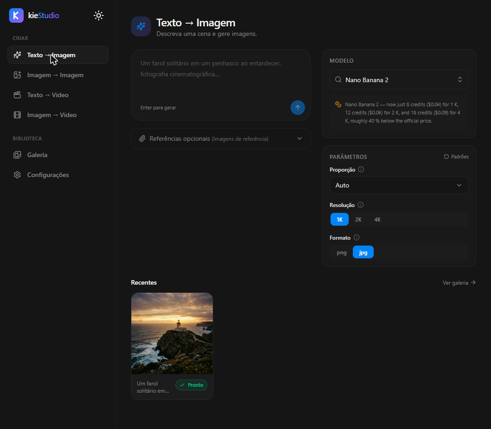

<div align="center">


# kieStudio

**Estúdio open source para gerar imagens e vídeos com IA, usando os 200+ modelos da [KIE](https://kie.ai).**

Texto → Imagem · Imagem → Imagem · Texto → Vídeo · Imagem → Vídeo

[Português](#-português) · [English](#-english)



</div>

---

## 🇧🇷 Português

### O que é

O kieStudio é uma interface web local e bonita para os modelos de imagem e vídeo da KIE (Nano Banana, GPT Image, Seedream, Kling, Veo, Seedance, Wan, Hailuo e muitos outros). Você escolhe o modelo, escreve o prompt e o app cuida do resto: upload de arquivos, fila, acompanhamento do status e galeria com histórico.

- 🎛️ **Formulário automático por modelo**: os parâmetros (proporção, duração, resolução, seed…) são gerados a partir do schema oficial de cada modelo. Modelos novos da KIE funcionam sem atualizar o código.
- 💰 **Preço à vista** antes de gerar e **saldo de créditos** sempre visível.
- 📤 **Upload com arrastar e soltar** para imagens, vídeos e áudios de referência.
- ⏱️ **Fila em tempo real** com avisos quando cada geração termina.
- 🖼️ **Galeria** com busca, filtros, player de vídeo, download, "copiar prompt", "reusar configurações" e exclusão.
- 💾 **Tudo salvo localmente**: histórico em SQLite e mídias baixadas automaticamente para a pasta que você escolher. Dá para desligar o salvamento em **Configurações → Armazenamento** (a KIE apaga os arquivos dela após 14 dias).
- 🌍 **Interface em Português, English e 中文**, trocável com um clique.
- 🔐 **Sua API key nunca vai para o navegador**: um servidor local faz as chamadas à KIE.
- 🌗 Tema escuro e claro, responsivo, animações com [beUI](https://beui.dev).

### Requisitos

- [Node.js](https://nodejs.org) **22.18 ou mais recente** (recomendado: 24 LTS)
- Uma API key da KIE: crie em <https://kie.ai/api-key>

### Instalação em 3 passos

```bash
# 1. Clone o repositório
git clone https://github.com/y9b/kiestudio.git
cd kiestudio

# 2. Instale as dependências
npm install

# 3. Rode
npm run dev
```

Abra **<http://localhost:5173>**. Na primeira vez, o app pede sua API key na tela de **Configurações**.

> Prefere usar arquivo? Copie `.env.example` para `.env` e preencha `KIE_API_KEY`.

### Uso no dia a dia (modo produção)

```bash
npm run build   # compila o app web
npm start       # serve app + API em http://localhost:8787
```

### Com Docker (opcional)

Só é útil se você não quer instalar o Node.js ou quer rodar o kieStudio num servidor ou NAS. Para uso normal no seu computador, o `npm run dev` acima basta.

```bash
cp .env.example .env    # preencha KIE_API_KEY (opcional)
docker compose up -d --build
```

Acesse <http://localhost:8787>. Os dados ficam em `./data`.

### Scripts

| Comando | O que faz |
| --- | --- |
| `npm run dev` | Sobe API (porta 8787) e app web com hot reload (porta 5173) |
| `npm run build` | Gera o build de produção do app web |
| `npm start` | Serve o app compilado e a API na porta 8787 |
| `npm run typecheck` | Verifica os tipos TypeScript |
| `npm run lint` | Roda o ESLint |

### Configuração (`.env`)

| Variável | Padrão | Descrição |
| --- | --- | --- |
| `KIE_API_KEY` | — | Sua chave da KIE. Também pode ser definida pela tela de Configurações. |
| `PORT` | `8787` | Porta do servidor |
| `HOST` | `127.0.0.1` | Use `0.0.0.0` para acessar de outros aparelhos da rede |
| `DATA_DIR` | `data` | Onde ficam o banco e as mídias |
| `DOWNLOAD_MEDIA` | `true` | Baixar os resultados para o disco |

### Estrutura do projeto

```
kiestudio/
├── apps/
│   ├── server/              # API local (Node + Hono + SQLite nativo)
│   │   └── src/
│   │       ├── index.ts     # rotas HTTP
│   │       ├── kie.ts       # cliente da API da KIE
│   │       ├── schema.ts    # converte o OpenAPI de cada modelo em campos de formulário
│   │       ├── poller.ts    # acompanha as tarefas e baixa os resultados
│   │       └── db.ts        # histórico e configurações (node:sqlite)
│   └── web/                 # app React 19 + Vite + Tailwind v4
│       └── src/
│           ├── components/  # componentes beUI (copiados de beui.dev)
│           ├── features/    # studio, galeria, configurações, layout
│           ├── state/       # estado do app, queries e toasts
│           └── lib/         # api, modos, utilidades
├── data/                    # criado na primeira execução (git-ignored)
├── Dockerfile
└── docker-compose.yml
```

### Como funciona

1. O app web pede ao servidor local a lista de modelos e o schema do modelo escolhido.
2. O servidor converte o schema OpenAPI em uma lista de campos, e o app renderiza o formulário.
3. Ao gerar, o servidor chama `createTask` na KIE e salva a tarefa no SQLite.
4. Um poller consulta `recordInfo` a cada 3 s. Quando a tarefa termina, ele baixa as mídias para `data/media`.
5. O app atualiza a fila e a galeria em tempo real.

### Contribuindo

Contribuições são bem-vindas!

1. Faça um fork e crie uma branch: `git checkout -b minha-melhoria`
2. Rode `npm run typecheck && npm run lint` antes de enviar
3. Abra um Pull Request explicando a mudança

Os componentes em `apps/web/src/components` vêm do [beUI](https://beui.dev) e podem ser atualizados com `npx shadcn@latest add @beui/<componente>` ou pelo endpoint `https://beui.dev/r/<componente>`.

### Licença

[MIT](LICENSE). O kieStudio não é afiliado à KIE. O uso dos modelos segue os termos e preços da KIE.

---

## 🇺🇸 English

**kieStudio** is an open-source, local web studio for generating images and videos with the 200+ AI models available on [KIE](https://kie.ai).

**Features:** auto-generated parameter forms from each model's official schema, so new KIE models work without code changes. It also has price and credit display, drag-and-drop uploads, a live queue with notifications, and a searchable gallery with download, copy prompt, reuse settings and delete. History is stored in local SQLite and outputs are downloaded automatically. Your API key stays on the local server. Dark/light themes, UI built with [beUI](https://beui.dev).

**Requirements:** Node.js ≥ 22.18 and a KIE API key (<https://kie.ai/api-key>).

```bash
git clone https://github.com/y9b/kiestudio.git
cd kiestudio
npm install
npm run dev        # http://localhost:5173
```

Set your key in the app's **Settings** screen, or copy `.env.example` to `.env` and fill in `KIE_API_KEY`.

**Production:** `npm run build && npm start` → <http://localhost:8787>.
**Docker:** `docker compose up -d --build` → <http://localhost:8787>.

Licensed under [MIT](LICENSE). Not affiliated with KIE.
